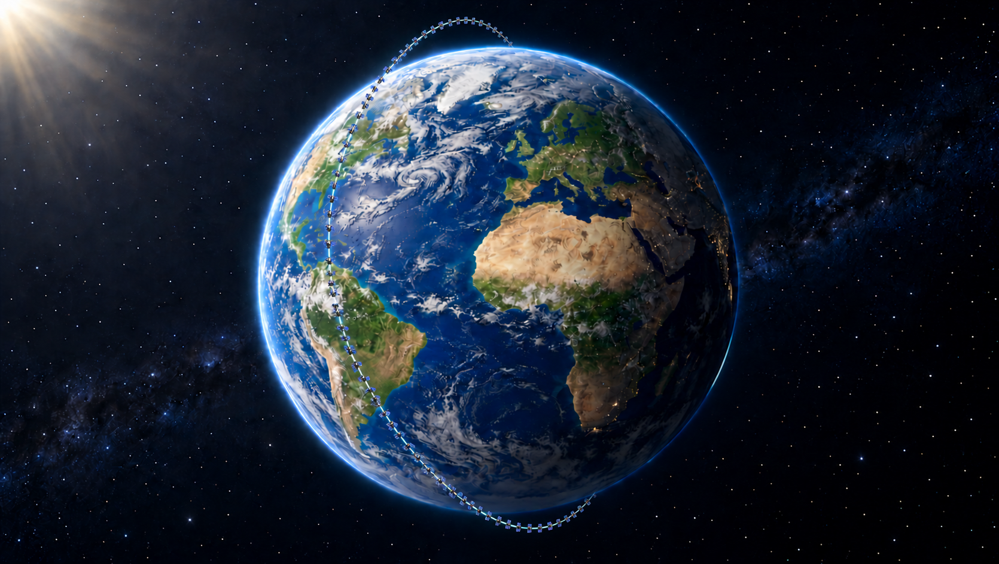

# Planet Downloader

*Schematic illustration of one near-polar orbital plane. Not to scale; not a representation of the full Planet fleet.*

Planet Downloader searches PlanetScope imagery for vector-defined study areas and downloads it to your computer. After you review the image count and estimated area in km², it requests coregistration and clipping, then produces masked daily mosaics on a consistent grid for each study area.

The application runs locally on Windows with an Italian browser interface. All settings are entered through the GUI; no code editing or Google Earth Engine account is required. An active Planet account with access to the requested imagery is necessary.

## Install and start

1. Install **Python 3.12, 64-bit**, from [python.org](https://www.python.org/downloads/windows/). Enable the Python launcher and **Add python.exe to PATH** in the installer.
2. Open [this repository](https://github.com/saveriofrancini/PlanetDownloader), select **Code → Download ZIP**, and extract the entire archive into a writable folder, such as `C:\PlanetDownloader`. Do not run files from inside the ZIP.
3. Double-click **`installa.bat`**. It creates a local Python environment, installs dependencies, and checks the installation. Internet access is required.
4. Double-click **`avvia.bat`**. The GUI opens in your browser. Keep the accompanying program window open while working.

For subsequent sessions, use `avvia.bat`. Run **`verifica_installazione.bat`** whenever you need to check Python and the required libraries; this diagnostic makes no Planet requests. Choose a local folder with enough space for downloaded assets, mosaics, and temporary files.

## Search, review, and download

1. Obtain your API key from your official [Planet account](https://www.planet.com/account/), under **My Settings**, and enter it in **Chiave API Planet**. See [Planet authentication guidance](https://docs.planet.com/develop/authentication/).
2. Select a vector dataset and click **Leggi le aree** (*Read areas*). Supported formats are GeoPackage, GeoJSON, and Shapefile. For Shapefiles, select the `.shp`, `.shx`, `.dbf`, and `.prj` files together, or provide a ZIP containing them. A defined coordinate reference system is required.
3. Choose a layer if the dataset contains several, and optionally specify the attribute containing area names. Each Polygon or MultiPolygon feature is processed independently; separate features are not dissolved. Areas are supplied as files, without drawing tools or a map.
4. Set the product, dates, filters, masking options, and output folder. **Sfoglia…** means *Browse*. The `examples/` folder contains an independent demonstration polygon and example settings; replace these with your study inputs.
5. Click **Cerca immagini** (*Search images*). The plan includes **all accessible scenes satisfying the filters**, not only the best image per month. Both date endpoints are included, using UTC acquisition dates. AOI quality checks may activate UDM2 assets and take several minutes; the search does not submit imagery orders.
6. Review the scene table, warnings, image counts, and km² estimate. **Esporta CSV** and **Esporta piano** export the table and plan. Changed parameters require a new search.
7. Click **Conferma e scarica** (*Confirm and download*) and accept the confirmation dialog to submit the planned orders. Keep the computer awake and connected.

**Salva impostazioni** / **Carica impostazioni** save and load settings as JSON. The API key is excluded.

## Products and parameters

The GUI supports PlanetScope surface reflectance and top-of-atmosphere radiance, each with **4 or 8 bands** and UDM2. Product availability and download permissions depend on the scene and account; university access does not automatically cover every product. SkySat, basemaps, tasking, and ARPS are not implemented.

| Parameter | Meaning and default |
|---|---|
| Product | Surface reflectance, 4 bands, by default. Select the radiometric product and band count needed for your analysis. |
| Start / end date | Inclusive UTC dates; initially the current year to today. |
| Maximum scene cloud | Metadata filter over the entire scene; default **30%**. A strict threshold can exclude a scene whose study area is clear. |
| Maximum AOI cloud | UDM2 cloud percentage within the scene–AOI intersection; default **20%**. Can be disabled. |
| Minimum AOI clear | UDM2 percentage classified as clear within that intersection; default **70%**. Can be disabled independently. |
| Minimum geographic coverage | Percentage of the AOI intersected by each scene; default **0%**. High thresholds can discard partial scenes needed to cover larger areas. |
| Standard quality / ground control | Both enabled by default; filter the corresponding Planet metadata. |
| Solar elevation / viewing angle | Minimum solar elevation **0°** and maximum viewing angle **30°**; available under advanced acquisition filters. |
| Clear pixels only | Enabled by default. Retains pixels classified as clear by UDM2. |
| Mask classes / confidence | Default confidence **70%**. When clear-only is disabled, choose exclusions among snow, shadow, light haze, heavy haze, and cloud. Pixels flagged unusable by UDM2 are always excluded. |
| Pixel size / EPSG | Default **3 m**. Leave EPSG empty for an automatically selected UTM projection per area, or enter a projected EPSG code using metres. Geographic EPSG:4326 is not an output-grid option. |
| Order batch size | Default **100** target scenes, maximum **499**. A reference image may be added to each batch. |

Scene cloud, AOI cloud, AOI clear, and geographic coverage measure different properties. A high clear percentage does not imply complete AOI coverage. To admit a non-clear class, disable clear-only as well as its class exclusion.

## Coregistration and mosaics

Coregistration is always requested through Planet. The application partitions the covered study area into non-overlapping zones and chooses a **fixed reference image for each zone across dates and order batches**. Images without successful coregistration delivery indicators are retained as downloaded assets but excluded from mosaics and reported.

All dates within an area share one output CRS, pixel size, extent, and grid. **A common grid does not establish geometric alignment between zones using different reference images**, nor certify absolute positional accuracy.

Locally, UDM2 masking is applied on the delivered image grid **before resampling and mosaicking**. Imagery is resampled bilinearly; quality masks use nearest-neighbour resampling. Where valid scenes overlap on the same UTC day, selection favours clear pixels and higher UDM2 confidence. All bands of a selected pixel come from the same scene. Missing coverage is not filled from other dates.

## Interpreting the km² estimate

The displayed estimate sums the geometric intersections of ordered scenes with their processing zones. It includes reference images repeated across batches and repeated processing for separate areas. The GUI also reports unique clipped area and full-scene area for comparison.

**This is not a contractual quotation or a guaranteed quota deduction.** Actual usage depends on your Planet agreement, clipping rules, rounding, and any permitted reuse. A scene excluded after coregistration may already have consumed quota. Local cloud masking does not retrospectively reduce usage. Check actual consumption in your Planet account before scaling up a workflow.

## Output files

Each run creates a `Planet_job_...` folder. Daily results are stored under `areas/AREA_ID/YYYY-MM-DD/`:

| File | Contents |
|---|---|
| `mosaic.tif` | Multiband GeoTIFF, `float32`, **NoData = -9999**. |
| `valid_mask.tif` | **1** for usable pixels; **0** for invalid or outside-area pixels. |
| `provenance.tif` | Source-scene index per pixel; **0** where invalid. |
| `metadata.json` | Grid, masking, band information, and provenance-index mapping. |

Downloaded Planet assets and coregistration reports remain in `orders/`. Area-level and run-level `summary.json` files record outputs, warnings, and failures; the saved plan and state support resumption.

The application preserves the product's numeric scale rather than converting values to physical units. PlanetScope surface reflectance is normally scaled by **10,000**: a value of 2,500 represents reflectance 0.25. Check product metadata before quantitative analysis, and do not apply that conversion automatically to radiance.

## Stop and resume

**Interrompi il lavoro locale** stops local work when possible; it **does not cancel orders already submitted to Planet**.

To resume, reopen the application, enter your API key, and enter the existing `Planet_job_...` path under **Riprendi un lavoro**. Click **Carica il lavoro**, review the saved plan, and confirm again. Keep the whole job folder. If submission status is uncertain, resume the same job rather than creating a new search that might duplicate an accepted order.

Completed downloads are checked and reused, including manifest checksums where provided. Downloads use temporary `.part` files, renamed atomically after verification; an interrupted file restarts from the beginning. Mosaics may be recomputed. If the search stopped before saving `plan.json`, repeat the search.

## Privacy and troubleshooting

The API key remains in session memory and is excluded from saved settings, plans, and logs. Download requests do not forward Planet authentication to storage hosts. The interface listens locally. This public repository contains synthetic examples, not the original study datasets, account credentials, or licensed test imagery.

| Problem | What to check |
|---|---|
| Installation or startup fails | Confirm Python **3.12 x64**, run `verifica_installazione.bat`, and read the terminal error. Check Internet access and folder permissions. |
| Browser cannot reach the app | Keep the launcher window open and use the local address it prints. |
| No images / HTTP 401 or 403 | Check the vector CRS, period, thresholds, API key, product permissions, and contractual coverage. |
| Long search or queued order | UDM2 activation and Planet processing take time. Read activity updates; resume the existing job instead of placing duplicate orders. |
| Proxy or certificate errors | Ask your administrator to configure Python's proxy/CA settings. Keep HTTPS verification enabled. |
| Incomplete mosaic | Inspect warnings, excluded scenes, the validity mask, and provenance. Clouds, partial coverage, or failed registration can leave gaps. |

## Validation and further reading

The documented validation includes **69 passing offline tests** and a live backend run using four-band surface reflectance on two dates. Downloads, common-grid outputs, and resumption were verified. Planet's reported registration matching score increased from **0.687 to 0.704**; this is not an independent positional-accuracy measurement.

The live test used Linux and one scene per date. Same-day multisource mosaicking and contaminated-pixel replacement were tested offline. The GUI was checked in Chromium on Linux; native Windows launchers and contractual quota consumption remain unverified. See [method and limitations](docs/method.md) and [validation scope](docs/validation.md).

Official references: [Data API](https://docs.planet.com/develop/apis/data/), [product bundles](https://docs.planet.com/develop/apis/orders/product_bundles/), [order tools and coregistration](https://docs.planet.com/develop/apis/orders/tools/), [PlanetScope products](https://docs.planet.com/data/imagery/planetscope/), and [UDM specifications](https://docs.planet.com/data/imagery/udm/).

## Contact and licence

Contact: [saverio.francini@unibo.it](mailto:saverio.francini@unibo.it).

A software licence has not yet been specified. Contact the maintainer about reuse or redistribution. Planet imagery remains subject to its applicable licence and account agreement.
